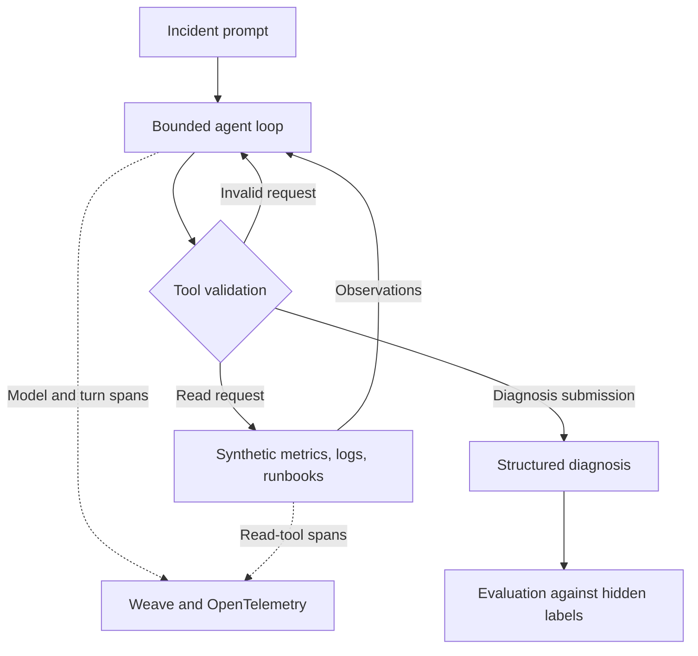

# Incident Triage Agent

[← Portfolio overview](../README.md)

**Type:** portfolio demo · **Data:** synthetic · **Actions:** no remediation capability

A bounded incident-triage agent that reads synthetic metrics, logs, and runbooks, then submits a structured diagnosis. The project combines cloud incident investigation with tool validation, LLM observability, and explicit evaluation.

## Problem and scope

An incident diagnosis needs more than a plausible explanation: it needs relevant evidence, an appropriate severity, and a way to recognize insufficient or conflicting information.

This demo explores those requirements in a controlled environment. It does not connect to customer production systems, perform remediation, or demonstrate a reduction in production incident-resolution time.

## Architecture

The diagram summarizes control flow. Synthetic observations and hidden evaluation labels are kept separate. The diagram does not represent a production deployment.

### Implemented controls

| Control | Behavior in the demo | Purpose |
| --- | --- | --- |
| Tool allowlist | Metrics, log search, runbook lookup, and diagnosis submission only | Keep tool use within a defined task scope |
| Argument validation | JSON/schema validation and case scoping | Reject malformed or out-of-scope requests |
| Execution bounds | Six model requests and ten tool attempts per case | Bound agent activity and make budget exhaustion observable |
| Invocation-local cache | Read results and timeouts are cached within one invocation; a new invocation starts empty | Avoid carrying observations across runs |
| Correction and fallback | Malformed calls receive bounded correction guidance; fallback remains an invalid submission | Prevent a fallback from being counted as a successful diagnosis |
| Provider failure handling | The first provider failure opens a circuit breaker; no automatic provider retries | Prevent uncontrolled retries |
| Action boundary | No shell or remediation tool is exposed; human approval remains required in the output | Keep the demo from executing operational changes |

## Implementation and observability

- Integrated W&B inference with a bounded tool-calling loop.
- Used Weave evaluation for case-level scoring and native OpenTelemetry spans for model, turn, and read-tool activity.
- Recorded request counts, tool activity, latency, and token usage for inspection.
- Included offline regression testing of protocol behavior, tool/budget boundaries, and SDK serialization.

Tracing helps explain what happened. It does not by itself establish that the diagnosis is correct. Quality scoring and trace inspection are separate parts of the evaluation.

## Evaluation methodology

| Item | Evaluation scope |
| --- | --- |
| Dataset | Eight synthetic cases |
| Model | `openai/gpt-oss-20b` |
| Evaluated version | v6r2 |
| Inputs | Synthetic incident prompts and case-scoped telemetry/runbook observations |
| Reference data | Hidden evaluation labels, separate from agent-visible observations |
| Checks | Diagnosis validity, root cause, severity, abstention, evidence-reference integrity, and approval boundaries |
| Comparison | Same aggregate strict-success result as the earlier v5 baseline |

The results below summarize retained evaluation outputs. They are not a new evaluation run or an independently reproduced benchmark. Public source code and raw evaluation rows are not included here, so this repository alone is not sufficient to reproduce the agent run.

## Recorded results

Each denominator below is the same set of **eight synthetic cases**.

| Metric | Recorded result | Interpretation |
| --- | --- | --- |
| Strict success | **6/8** | Passed the project's overall strict-success scorer |
| Valid submitted diagnosis | **7/8** | Produced a valid diagnosis submission; validity does not establish correctness |
| Severity correctness | **6/8** | Matched the case's severity label |
| Evidence-reference integrity | **8/8** | Passed the evidence-reference checks; this does not establish semantic correctness |
| Approval boundary | **8/8** | Passed the demo's approval-boundary checks within its read-only tool scope |

All eight outputs required human approval and recorded no executed actions.

**Limits:** strict success was unchanged from v5. The results establish neither an accuracy improvement nor production readiness. The approval-boundary score describes these eight cases and is not a general safety guarantee.

## Failure analysis

| Scenario | Observed behavior | Engineering implication |
| --- | --- | --- |
| Unknown telemetry | Exhausted the six-request budget without a valid submission | Returning a fallback with an insufficient-evidence label is not equivalent to completing the required submission protocol |
| Conflicting evidence | Submitted an incorrect database/SEV2 diagnosis | A valid output and valid evidence references can still support a semantically incorrect conclusion |

These failures are part of the result. They remain visible rather than being excluded from the headline score.

## Safety boundaries

- The agent reads synthetic data and cannot execute shell commands or remediation actions.
- Human approval is represented as a required condition in the outputs. A production approval-and-execution workflow has not been validated by this demo.
- Tool validation, case scoping, and request budgets constrain behavior, but the eight-case evaluation is not a comprehensive adversarial security assessment.
- Evidence-reference checks and task-quality checks are reported separately.

## Production readiness: remaining work

The following are next validation steps, not completed project outcomes:

1. Expand testing with representative, held-out cases and repeated runs; measure performance by failure category.
2. Improve handling of unknown and conflicting telemetry, including abstention and submission behavior.
3. Validate real telemetry integrations, access controls, data handling, and auditability in an appropriate test environment.
4. Implement and test an enforceable approval workflow before considering any action-execution capability.
5. Evaluate adversarial inputs, provider outages, latency, cost, and load under realistic operating conditions.

## Evidence and publication boundaries

The architecture description and metrics were checked against retained project documentation, score summaries, and recorded case outputs. This document publishes a scoped summary rather than the underlying private implementation or run records.

No customer data, credentials, private repository URLs, or private trace identifiers are included. The work is presented as a technical portfolio demo; it is not attributed to a customer engagement or a production deployment.
